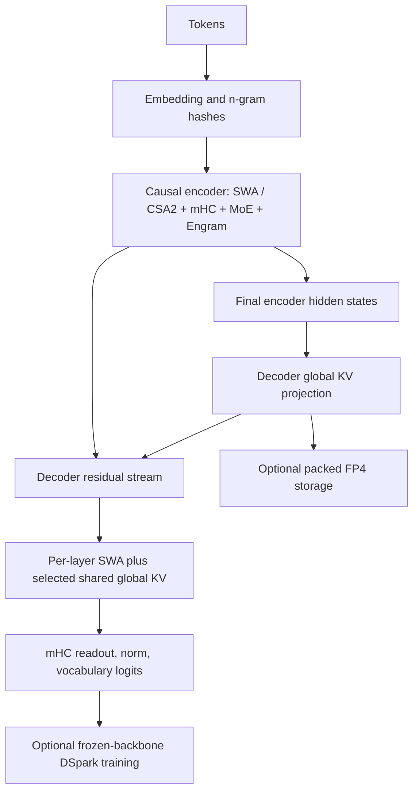

# Scaled V4.1 text architecture

This is a small, trainable **text backbone**, not just the dense cross-layer KV experiment. The original GPT and its checkpoints remain unchanged by default. Select `architecture=deepseek_v41` to build the new model. Its shape, number of experts, memory tables, attention window and sparse budget are configurable.

Sources are the user-supplied technical report (sections 2.2-2.4 and 3.2.2) and the official MIT [minimal inference implementation](https://huggingface.co/deepseek-ai/DeepSeek-V4.1-Flash/blob/314113f8a7dadb388215396ba5fbee2c610a04d6/inference/model.py). See [pinned provenance and license](../sources/deepseek-v41/PROVENANCE.md). No released weights are downloaded; this model is initialized and trained from scratch.



## Implemented structure

| Component | Implementation and acceptance |
| --- | --- |
| CED | Even depth split into equal encoder/decoder halves. Every decoder global KV producer projects from final encoder hidden states, independently of its own residual. Tested by perturbing decoder mixing and confirming global KV is unchanged. |
| Local/global latent attention | Each layer owns a local shared K=V latent; CSA2 additionally attends to compressed global latents. Low-rank Q and grouped low-rank output, learned RMSNorm, partial adjacent-pair RoPE, inverse output RoPE, and a learned attention sink. Joint softmax covers local/global entries plus the sink. |
| Compression | Learned channel-wise softmax pooling of non-overlapping token groups. Encoder ratio defaults to 2, decoder ratio to 1. An entry becomes visible only after its whole source group is complete. Partial groups survive streaming/chunk boundaries. |
| Full / Reindex / Reuse | Full projects main KV and index keys. Reindex has independent index Q/weights but shares KV/index K. Reuse shares the latest selected positions without another indexer. The three modes have distinct parameters and execution paths. |
| Hierarchical indexer | First decoder Full scores all visible entries, selects candidate blocks, then subsequent indexers gather and score only that bounded candidate pool. Stable positional tie-breaking preserves causality/chunk consistency when ReLU scores tie at zero. |
| Indexer training | Auxiliary KL objective from detached main-query attention scores. Training loss includes this objective; evaluation BPB/CE excludes it. This training recipe is an explicit portable choice because the released reference is inference-only. |
| MoE | One shared SwiGLU expert plus selected routed experts (4/2 in acceptance runs). Sqrt-softplus gate; correction biases affect selection only. Counts are balanced once per optimizer step; training/Engine/base/SFT/RL loading routes are wired. |
| Single-Pass mHC | Multiple residual streams, sigmoid input/output mixes, doubly stochastic Sinkhorn residual mixing. Each sublayer consumes the preceding sublayer's pre-mix, while producing the next pre-mix. This is the dependency structure, not a fused Mega-mHC kernel. |
| Engram | Orders 2/3/4, independent prime-sized multi-head embedding tables, stream-specific normalized signed-sqrt gates, two scaled encoder placements, no causal convolution. Unicode/space/lowercase token compression is optional and stored in checkpoints; acceptance runs apply it. |
| FP4 main KV | Optional E2M1 packed nibbles with E4M3 scales per 16 channels, after RoPE. Actual storage is 4.5 bits per main-latent value, including scales. Straight-through QAT is used when enabled. Local and index caches stay BF16 in GPU runs. |
| Decoder bounded replay | Keep full encoder/global prompt processing, run decoder SWA only on the final window. Approximate states are opt-in and measured independently of exact inference. |
| Encoder bounded replay | `cache.drop_local()` simulates missing persistent SWA. `model.replay_prefix(cache, prefix_ids, suffix_ids)` replays only the last window plus uncached suffix. Cached global prefix entries are read without recomputation/overwrite; only suffix tokens append global KV. |
| DSpark-style forward | Three local draft blocks produce five parallel base positions, a Markov head conditions on prior drafts, and a confidence head learns greedy-acceptance targets. Backbone projections/features are detached; frozen-backbone gradients are checked. Scheduler accepts caller-profiled verification costs. Main generation remains ordinary verified-by-backbone autoregression. |

The default small schedule is encoder `S,F,I,R` and decoder `F,I,R,R` at depth 8. Patterns are explicit config fields; they need not have the full-scale layer counts. For the report's depth-40 schedule use `local_only_layers=2`, encoder pattern `FRRRRR`, and a full 20-layer decoder pattern `FRRRIRRRIRRRIRRRIRRR`.

## Reference limits

- No vision encoder/projector, image-token routing or multimodal training. This is the GPT/text scope.
- No released checkpoint/table compatibility. Engram uses a portable polynomial hash, rather than the released XOR/multiplier layout. Tokenizer compression follows its normalization policy, not released token IDs.
- No FP8 SWA/indexer kernels, FP4 expert GEMM, head-wise Muon, Sinkhorn embedding updates, expert parallelism, RDMA prefetch or pipeline-stage cache management. The initial optimizer is explicitly grouped AdamW, with fp32 master weights and existing COMPUTE_DTYPE activations.
- Sparse attention uses PyTorch gather/einsum. Full index selection currently uses stable sorting; this is a correctness reference, not the optimized linear-time top-k path. FP4 reads dequantize the populated global cache before attention, so packed storage savings are not a dequantization-free latency claim.
- No YaRN million-token-quality claim, automatic prompt-cache service, or speed claim for DSpark. A drafter cannot safely emit unverified tokens. The confidence scheduler interface still needs real engine profiling and a verified speculative generator before any acceleration claim.
- Bounded replay intentionally changes hidden states. Post-training adaptation is not established by these short acceptance runs.
- Multi-GPU training is explicitly rejected by the V41 reference optimizer until gradient reduction is implemented. Existing GPT distributed training is preserved.

## Using the model

```python
import torch
from nanochat.deepseek_v41 import V41Config, DeepSeekV41

config = V41Config(n_layer=8, n_embd=256, n_head=4, head_dim=64)
with torch.device("meta"):
    model = DeepSeekV41(config)
model.to_empty(device="cuda")
model.init_weights()
# Optional before training: model.compress_engram_tokenizer(tokenizer)
cache = model.create_kv_cache(batch_size=1, seq_len=2048)
with torch.inference_mode():
    logits = model(prompt_ids, kv_cache=cache)
```

`Engine` uses the model's cache factory automatically. Cache state is owned by the request, not module globals. It supports single-prompt batch cloning, reset, per-layer bounded SWA and per-producer global/index storage. Inference with missing local state rejects normal decoding until the caller restores it with `replay_prefix`.

Standard pretraining integration (single GPU, after normal data/tokenizer setup):

```bash
python -m scripts.base_train --architecture deepseek_v41 --no-compile \
    --depth 8 --aspect-ratio 16 --head-dim 32 --max-seq-len 128 \
    --v41-window-size 16 --v41-topk 8 --v41-experts 4 \
    --device-batch-size 2 --total-batch-size 256 --num-iterations 512 \
    --model-tag v41-d8 --run dummy --sample-every -1 --core-metric-every -1
```

For the exact acceptance configuration and fixed corpus use `python -m dev.train_v41 --help`. This separate runner saves model/optimizer/metadata, rebuilds the model from saved files, measures streaming/replay errors, generates actual tokens and trains a frozen-backbone drafter. The two command paths expose different configuration defaults; inspect the saved `model_config` before comparing results.

`checkpoint_manager.build_model` dispatches on `model_config.architecture`. Base/SFT/RL inference uses the existing loader and Engine. Entire SFT/RL training and large-scale compiled inference have not been accepted as complete merely because model loading is integrated.
